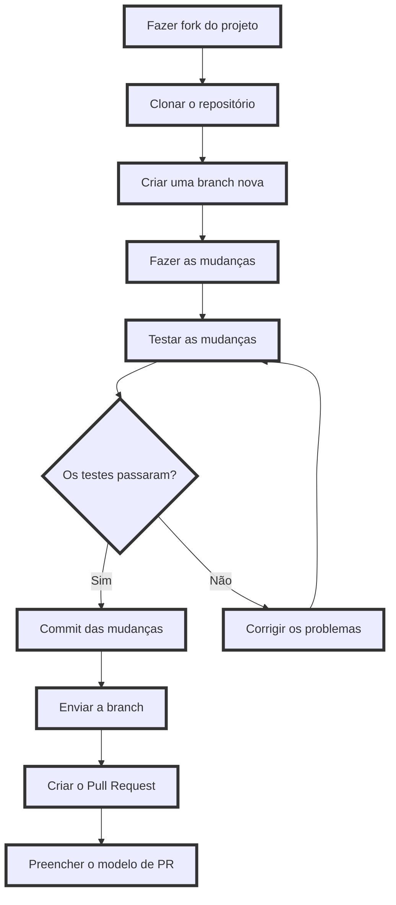
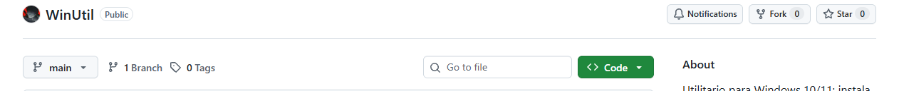
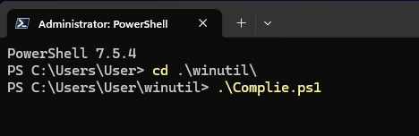
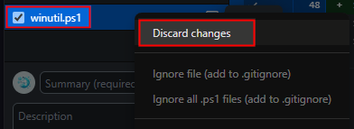
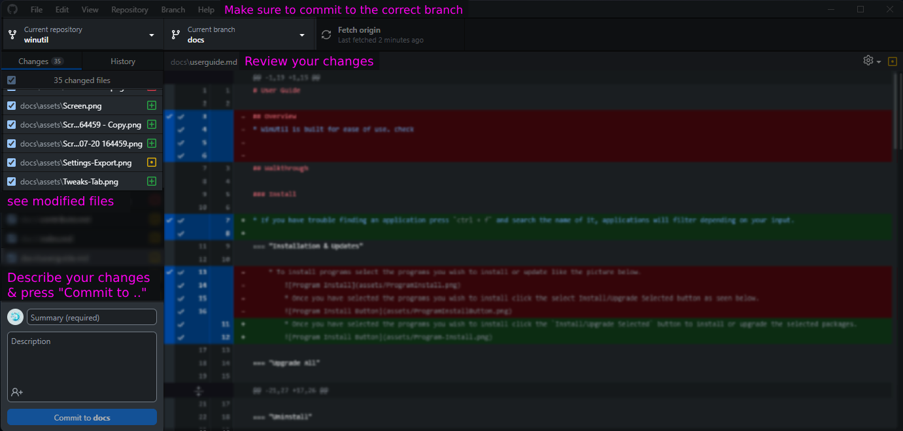
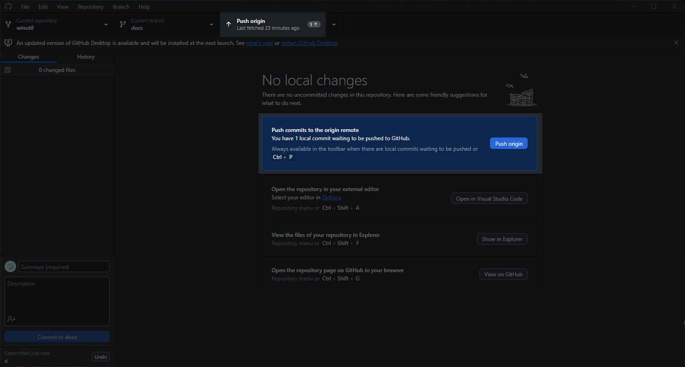

# Como contribuir

## Testando

* Teste as mudanças mais recentes do WinUtil rodando a pré-versão e relatando os problemas que encontrar — é assim que o projeto melhora.

#### **Rodar a pré-versão mais recente**

```ps1
irm https://github.com/RamonMods/WinUtil/releases/latest/download/winutil.ps1dev | iex
```

> [!CAUTION]
> **Atenção:** isto é uma pré-versão e deve ser tratado como tal. Ela existe para desenvolvedores testarem e reportarem/corrigirem bugs antes de chegarem na versão estável. Não use em produção.

## Problemas (issues)

* Se você encontrar qualquer problema com o script, abra uma issue na aba "Issues" do repositório. Preenchendo o modelo, você dá os detalhes necessários para eu (e a comunidade) resolver o bug ou avaliar o pedido de recurso.

## Contribuir com código

* Pull requests são tratados direto na **branch MAIN**. Isso porque agora dá para escolher qual release publicar pelo GitHub Releases.

* Se você vai mexer em código, mande o PR para a branch `main`.

> [!IMPORTANT]
> Não use formatador de código, não faça mudanças massivas de linha e não misture várias funcionalidades. CADA FUNCIONALIDADE DEVE SER UM PULL REQUEST PRÓPRIO.
>
> Não abra PR adicionando suporte a outros idiomas por enquanto.

* Ao criar um pull request, documente tudo o que mudou. Isso inclui qualquer coisa adicionada à seção `tweaks` e o `undo tweak` correspondente, para o usuário conseguir remover o ajuste novo se precisar. Toda mudança de código precisa de documentação. Explique na descrição do PR o que mudou e por quê. PR fora desse formato pode ser recusado, e código sem documentação suficiente também.

* Seguindo essas regras, mantemos a qualidade e o código organizado e documentado.

> [!NOTE]
> Ao criar uma função, inclua "WPF" ou "WinUtil" no nome do arquivo para ela ser carregada no runspace.

## Passo a passo

* Guia para quem está começando. Se ainda tiver dúvida, veja a documentação oficial do GitHub:
    * [Commit pela web](https://docs.github.com/en/pull-requests/committing-changes-to-your-project/creating-and-editing-commits/about-commits)
    * [Commit pelo GitHub Desktop](https://docs.github.com/en/desktop/making-changes-in-a-branch/committing-and-reviewing-changes-to-your-project-in-github-desktop#about-commits)
    * [Criar um Pull Request](https://docs.github.com/en/pull-requests/collaborating-with-pull-requests/proposing-changes-to-your-work-with-pull-requests/creating-a-pull-request)


### Visão geral



> [!NOTE]
> Este diagrama é um guia do processo. Ele pode mudar conforme o tipo de mudança.

### Fazer o fork

* Faça o fork do WinUtil [aqui](https://github.com/RamonMods/WinUtil) para criar uma cópia na sua lista de repositórios.



### Clonar o fork

> [!TIP]
> Dá para editar direto pela web, mas recomendamos clonar o repositório com o GitHub Desktop (disponível no WinUtil) para testar o seu fork com facilidade.

* Instale o GitHub Desktop se ainda não tiver.
* Entre com a mesma conta do GitHub usada no fork.
* Escolha o fork em "Your Repositories" e clique em "clone {nome do repo}".
* Crie uma branch nova com um nome ligado à sua mudança.

* Agora é só editar o WinUtil no seu editor preferido.


### Testar as mudanças

* Para ver se funcionou, rode os comandos abaixo num terminal PowerShell como administrador:

* Vá para a pasta do projeto clonado.
* `cd {caminho da pasta com o Compile.ps1}`
* Compile e abra o WinUtil:
* `.\Compile.ps1 -run`




Abra o PowerShell como Administrador.

* Depois de confirmar que está tudo certo, faça o commit e abra o PR. Ajuda extra está na documentação abaixo.


### Fazer o commit

* Antes do commit, descarte as mudanças feitas no arquivo `winutil.ps1`, como na imagem:



* Com o resultado do jeito que você quer, faça o commit.



* Envie as mudanças para o seu fork no GitHub.



### Abrir o PR

* Para abrir um PR da sua branch para a main, vai aparecer um botão "Preview and Create pull request". Clique nele e preencha tudo o que o modelo pede. Antes de abrir, confira se não tem nenhum arquivo `WinUtil.ps1` anexado ao PR. Estando tudo certo, abra o PR e aguarde o Ramon (mantenedor) aceitar ou recusar. Quando for aceito, a mudança aparece na build de pré-versão.
* Leia os comentários do modelo: alguns explicam como apresentar o PR para o GitHub rotular direito.
* Se a sua funcionalidade ainda não aparecer na versão estável, é normal. Tudo entra primeiro na pré-versão para garantir que está funcionando antes de ir para o público.
* Parabéns! Você acabou de mandar seu primeiro PR. Obrigado por contribuir com o WinUtil.
