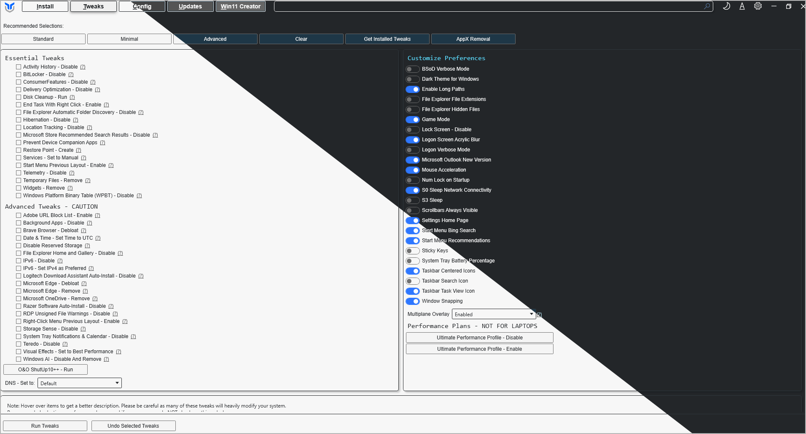

# WinUtil — utilitário para Windows em português

[](https://github.com/RamonMods/WinUtil/releases/latest)
[](https://github.com/RamonMods/WinUtil/releases)
<a href="https://pixgg.com/ramon"></a>

Um só lugar para **instalar programas**, **enxugar o Windows** com ajustes, **consertar** o que quebrou e **controlar as atualizações**. Feito para rodar do zero em cada instalação nova do Windows 10 ou 11.



---

## Início rápido

> **Precisa rodar como Administrador** — o WinUtil altera o sistema de verdade.

Abra o PowerShell ou o Terminal como administrador e cole:

```ps1
irm https://github.com/RamonMods/WinUtil/releases/latest/download/winutil.ps1 | iex
```

Rodando do código-fonte desta pasta:

```powershell
.\Compile.ps1 -Run
```

### Como abrir um terminal como administrador

- **Menu Iniciar:** clique com o botão direito em Iniciar → *Windows PowerShell (Admin)* ou *Terminal (Admin)*
- **Pesquisa:** aperte a tecla `Windows`, digite `PowerShell` ou `Terminal` e use `Ctrl + Shift + Enter`

---

## As abas

| Aba | O que faz | Números |
|---|---|---|
| **Instalar** | Instala programas por winget ou Chocolatey, com busca, categorias e ícones | 200+ programas no catálogo |
| **Ajustes** | Liga e desliga recursos do sistema com opção de desfazer | 100+ ajustes |
| **Configurações** | Conserta Windows Update, rede, winget e faz reparo do sistema | 6 correções |
| **Atualizações** | Define se o Windows Update fica padrão, desligado ou só com segurança | 3 modos |
| **Recursos** | Liga recursos opcionais do Windows (.NET, Hyper-V, WSL etc.) | por edição do Windows |
| **Criador do Win11** | Monta uma ISO do Windows 11 com ajustes e programas embutidos | ISO + USB |
| **Aparência** | Tema claro/escuro e cor de destaque da interface | 2 temas |

---

## Automação / predefinições

Aplique uma configuração pronta sem clicar em nada:

```powershell
& ([ScriptBlock]::Create((irm https://github.com/RamonMods/WinUtil/releases/latest/download/winutil.ps1))) -Preset Standard
```

| Predefinição | O que é |
|---|---|
| `Standard` | Equilíbrio para a maioria dos usuários |
| `Minimal` | Mexe o mínimo possível |
| `Advanced` | Ajustes profundos, para quem sabe o que está fazendo |

O que cada predefinição faz exatamente está em [`config/preset.json`](config/preset.json).

Também dá para exportar/importar a seleção pela própria interface (`Configurações → Importar/Exportar`), em JSON.

---

## Compilar e desenvolver

```powershell
.\Compile.ps1          # gera winutil.ps1 a partir de functions/, config/ e xaml/
.\Compile.ps1 -Run     # gera e abre a interface
```

Testes (Pester 5.8.0):

```powershell
Install-Module -Name Pester -RequiredVersion 5.8.0 -Repository PSGallery -Scope CurrentUser -Force -SkipPublisherCheck
Import-Module Pester -RequiredVersion 5.8.0 -Force
Invoke-Pester -Path 'pester/*.Tests.ps1' -Output Detailed -CI
```

Guia de contribuição: [`.github/CONTRIBUTING.md`](.github/CONTRIBUTING.md) · contrato do projeto: [`SPEC.md`](SPEC.md) · regras para agentes: [`AGENTS.md`](AGENTS.md).

---

## Documentação

- Código e issues: <https://github.com/RamonMods/WinUtil>
- Documentação em `docs/` (Astro Starlight) — veja [`docs/README.md`](docs/README.md) para rodar localmente
- Referência de funções: [`docs/src/content/docs/code-reference/`](docs/src/content/docs/code-reference)

---

## Apoiar o projeto

<a href="https://pixgg.com/ramon"></a>

Pix: **[pixgg.com/ramon](https://pixgg.com/ramon)**

Deixe uma ⭐ no repositório se o projeto te ajudou — é de graça e ajuda bastante.

---

## Créditos

Este projeto é um fork traduzido e adaptado do [WinUtil de Chris Titus Tech](https://github.com/ChrisTitusTech/winutil), distribuído sob a licença MIT. O aviso de copyright original foi preservado no [`LICENSE`](LICENSE), como a licença exige.
