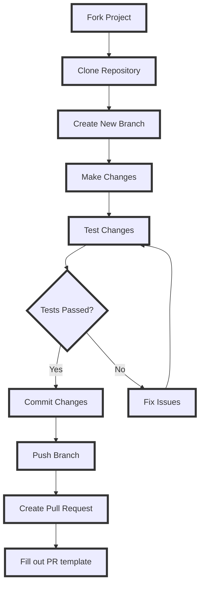
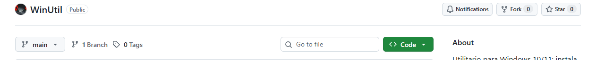
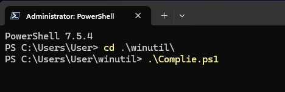
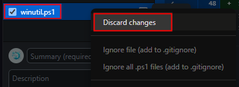
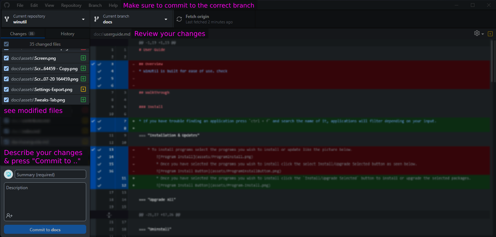
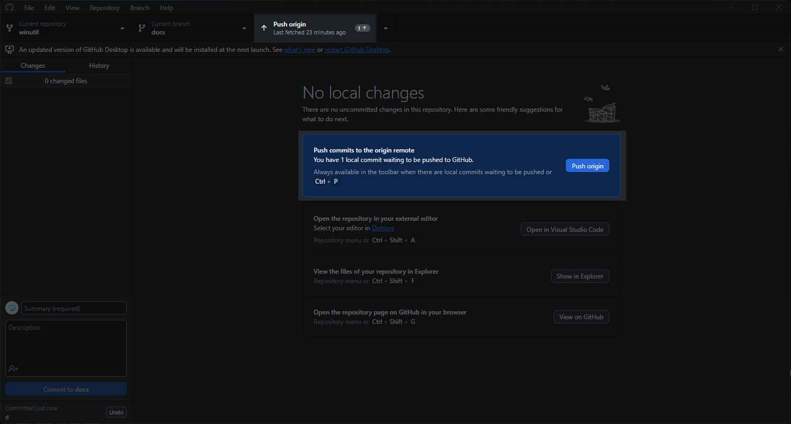

## Testes

* Teste as mudanças mais recentes do WinUtil executando a pré-versão e relatando os problemas que encontrar, para nos ajudar a melhorar o WinUtil continuamente!

#### Execute a pré-versão mais recente

```ps1
irm https://github.com/RamonMods/WinUtil/releases/latest/download/winutil.ps1dev | iex
```

:::caution
**Lembre-se** de que esta é uma pré-versão e deve ser tratada como tal. Ela existe para que os desenvolvedores testem o utilitário e relatem ou corrijam bugs antes que eles cheguem à versão estável. Não a use em produção!
:::

## Issues

* Se você encontrar qualquer dificuldade ou problema com o script, peço gentilmente que o envie pela aba "Issues" do repositório no GitHub. Preenchendo o template fornecido, você pode dar detalhes específicos sobre o problema, permitindo que eu (e outras pessoas da comunidade) resolva rapidamente os bugs ou considere pedidos de recursos.

## Contribuir com código

* Os pull requests agora são tratados diretamente na **branch MAIN**. Isso foi feito porque agora podemos selecionar versões específicas para executar por meio das releases no GitHub.

* Se você for fazer mudanças de código, pode enviar um PR para a branch `main`.

:::caution
Não use um formatador de código, não faça quantidades enormes de mudanças de linha nem faça várias mudanças de recursos de uma vez. CADA MUDANÇA DE RECURSO DEVE SER SEU PRÓPRIO PULL REQUEST!
:::

:::caution
Não abra um pull request que adicione suporte a outros idiomas ao WinUtil por enquanto, até decidirmos como queremos seguir com o suporte a idiomas.
:::

* Ao criar pull requests, é essencial documentar detalhadamente todas as mudanças feitas. Isso inclui, mas não se limita a, documentar qualquer adição feita à seção `tweaks` e ao `undo tweak` correspondente, para que os usuários consigam remover os ajustes recém-adicionados se necessário, e uma documentação completa é obrigatória para todas as mudanças de código. Documente suas mudanças e explique brevemente por que as fez na descrição do Pull Request. O descumprimento desse formato pode resultar na recusa do pull request. Além disso, qualquer código sem documentação suficiente também pode ser recusado.

* Seguindo estas diretrizes, mantemos um alto padrão de qualidade e garantimos que a base de código continue organizada e bem documentada.

:::note
Ao criar uma função, inclua "WPF" ou "WinUtil" no nome do arquivo para que ela seja carregada no runspace.
:::

## Passo a passo

* Este é um guia para iniciantes. Se você ainda tiver problemas, consulte a seguinte documentação oficial do GitHub:
    * [Commit pela WEB](https://docs.github.com/en/pull-requests/committing-changes-to-your-project/creating-and-editing-commits/about-commits)
    * [Commit pelo GitHub Desktop](https://docs.github.com/en/desktop/making-changes-in-a-branch/committing-and-reviewing-changes-to-your-project-in-github-desktop#about-commits)
    * [Criar um Pull Request](https://docs.github.com/en/pull-requests/collaborating-with-pull-requests/proposing-changes-to-your-work-with-pull-requests/creating-a-pull-request)


### Visão geral



:::note
Este é um diagrama para orientar você no processo. Ele pode variar conforme o tipo de mudança que você está fazendo.
:::

### Faça um fork do repositório
* Faça um fork do repositório do WinUtil [aqui](https://github.com/RamonMods/WinUtil) para criar uma cópia que ficará disponível na sua lista de repositórios.



### Clone o fork
:::tip
Embora você possa fazer suas mudanças direto pela Web, recomendamos clonar o repositório para o seu dispositivo usando o aplicativo GitHub Desktop (disponível no WinUtil) para testar seu fork com facilidade.
:::

* Instale o GitHub Desktop se ele ainda não estiver instalado.
* Faça login com a mesma conta do GitHub que você usou para fazer o fork do WinUtil.
* Escolha o fork em "Your Repositories" e pressione "clone `{repo name}`"
* Crie uma nova branch e dê a ela um nome relacionado às suas mudanças.

* Agora você pode modificar o WinUtil como quiser usando seu editor de texto preferido.


### Testando suas mudanças

* Para testar se suas mudanças funcionam como esperado, execute os seguintes comandos em um terminal PowerShell como administrador:

* Mude o diretório em que você está executando os comandos para o projeto do fork.
* `cd {path to the folder with the compile.ps1}`
* Execute o comando a seguir para compilar e rodar o WinUtil:
* `.\Compile.ps1 -run`



* Depois de ver que suas mudanças funcionam corretamente, fique à vontade para enviar as mudanças ao repositório e abrir um PR. Para ajuda nisso, siga a documentação abaixo.

### Enviando as mudanças
* Antes de enviar suas mudanças, descarte as alterações feitas no arquivo `winutil.ps1`, como a seguir:



* Agora envie suas mudanças quando estiver satisfeito com o resultado.



* Faça push das mudanças para enviá-las ao seu fork no GitHub.



### Abrindo um PR
* Para abrir um PR no seu repositório a partir de uma nova branch ligada à branch main, um botão aparecerá dizendo Preview and Create pull request. Clique nesse botão e preencha todas as informações fornecidas no template. Depois de preencher tudo corretamente, verifique seu PR para garantir que não há nenhum arquivo WinUtil.ps1 anexado a ele. Quando tudo estiver certo, abra o PR e aguarde o Ramon (o mantenedor) aceitar ou recusar seu PR. Assim que for aceito pelo Ramon, você poderá ver suas mudanças na build "/windev".
* Preste atenção aos comentários presentes no template, alguns deles falam sobre a apresentação adequada do seu PR, o que permite que o GitHub o rotule corretamente
* Se você não vir seu recurso na build principal "/win", não há problema. Todas as novas mudanças vão para a build /windev para garantir que tudo funcione bem antes de ficar totalmente público.
* Parabéns! Você acabou de enviar seu primeiro PR. Muito obrigado por contribuir com o WinUtil.
