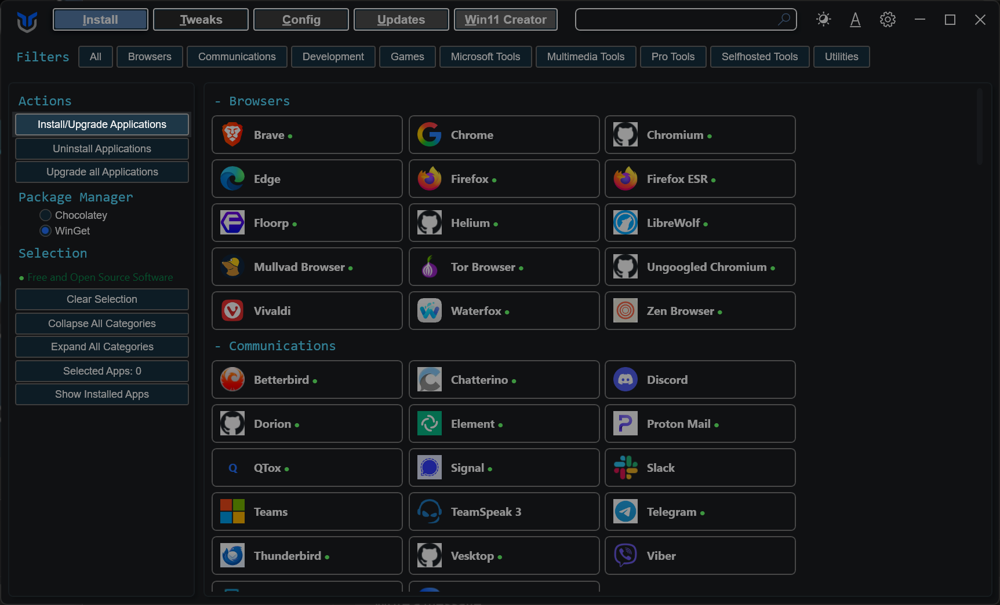
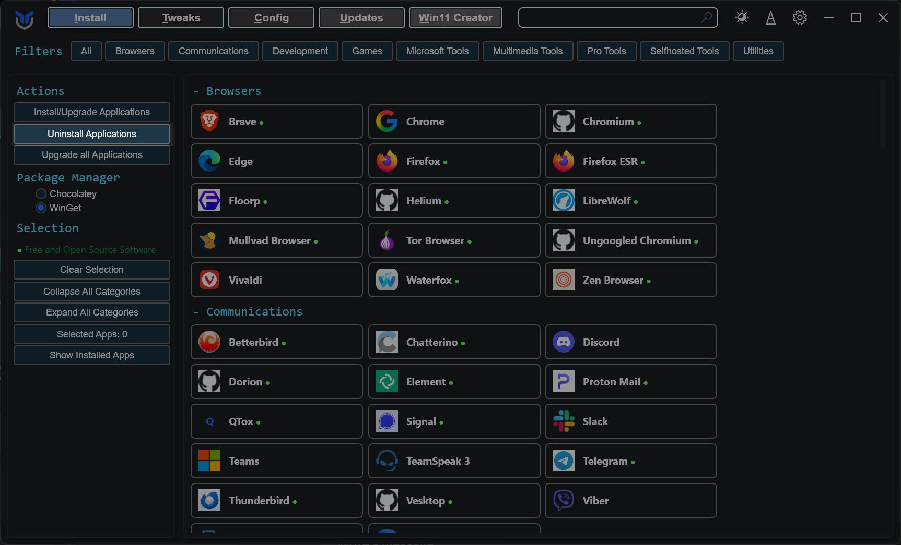
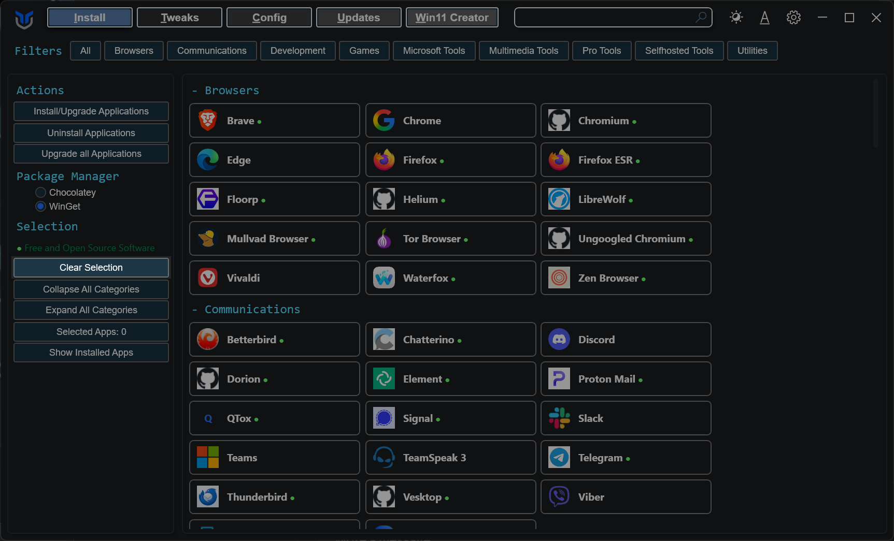
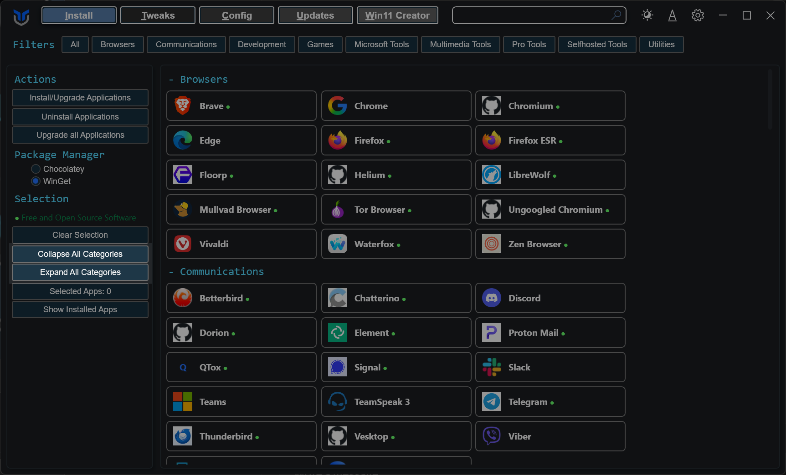
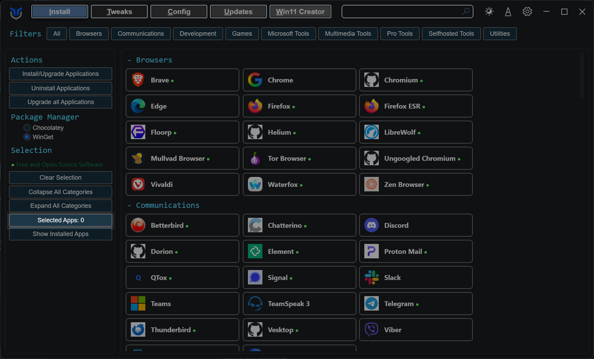
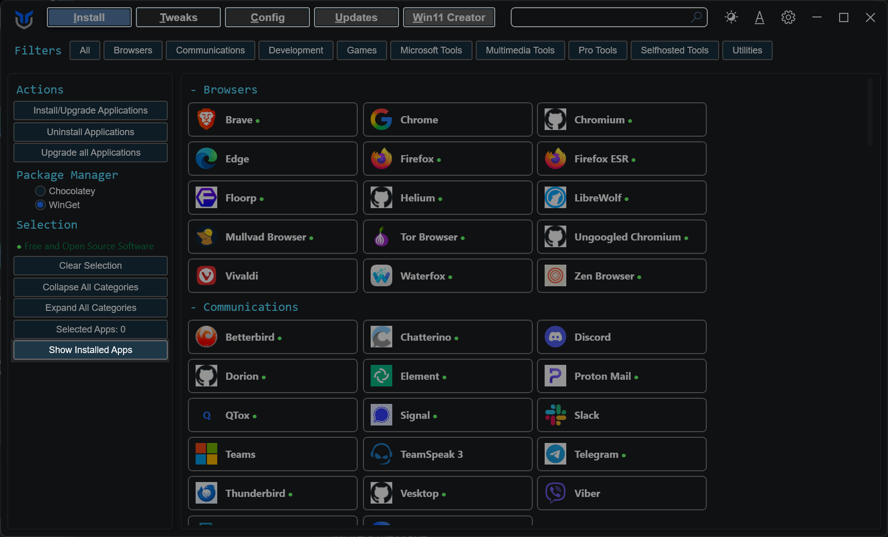

import { Tabs, TabItem } from '@astrojs/starlight/components';

Use a aba Aplicativos para instalar, atualizar, desinstalar e revisar os apps compatíveis em um só lugar. O WinUtil depende do suporte do gerenciador de pacotes para essas ações, então os resultados disponíveis dependem do que o WinGet consegue detectar e gerenciar no seu sistema.

Os cartões de aplicativo usam ícones incluídos, para aparecerem sem requisição de rede, e se redimensionam para dividir a largura disponível da linha. Se faltar um ícone, o WinUtil tenta o favicon do site do aplicativo e mostra uma letra se essa busca falhar.

Durante a instalação, desinstalação ou atualização de aplicativos, a aba mostra um indicador de carregamento e o status ao vivo. A lista de aplicativos volta quando a tarefa termina; a barra de progresso mantém o resultado final.

<Tabs>
<TabItem label="Instalar e atualizar">
* Escolha os aplicativos que deseja instalar ou atualizar.
    * Para programas que não estão instalados, esta ação os instalará.
    * Para programas já instalados, esta ação os atualizará para a versão mais recente.
* Clique no botão `Instalar/atualizar selecionados` para iniciar o processo de instalação ou atualização.

</TabItem>
<TabItem label="Desinstalar">
* Selecione os programas que deseja desinstalar.
* Clique no botão `Desinstalar selecionados` para removê-los.

</TabItem>
<TabItem label="Atualizar tudo">
* Basta pressionar o botão `Atualizar tudo`.
* Isso atualiza todos os programas instalados compatíveis, sem seleção individual.

</TabItem>
<TabItem label="Limpar seleção">
* Clique no botão `Limpar seleção`.
* Isso limpa todas as seleções atuais.

</TabItem>
<TabItem label="Recolher e expandir categorias">
* Clique em `Recolher todas as categorias` para fechar todas as categorias e reduzir a lista apenas aos cabeçalhos das categorias.
* Clique em `Expandir todas as categorias` para reabrir todas as categorias e mostrar todos os aplicativos novamente.

</TabItem>
<TabItem label="Filtros de categoria">
* Clique em um chip de categoria no topo da aba para mostrar apenas aquela categoria. O chip fica destacado enquanto o filtro estiver ativo.
* Segure `Ctrl` e clique para adicionar mais categorias ao filtro, ou para remover uma delas.
* Clique em `Tudo`, ou clique de novo na categoria destacada quando for a única selecionada, para limpar o filtro.
* Categorias com resultados correspondentes abrem enquanto um filtro está ativo. As que a filtragem abriu para você voltam a ficar recolhidas quando você limpa o filtro; as que você abriu por conta própria continuam abertas.
</TabItem>
<TabItem label="Contador de apps selecionados">
* O contador `Apps selecionados` na barra lateral mostra quantos aplicativos estão selecionados no momento.
* Use-o para acompanhar sua seleção enquanto navega pelas categorias.

</TabItem>
<TabItem label="Mostrar apps instalados">
* Clique no botão `Mostrar apps instalados`.
* Isso procura e seleciona os aplicativos instalados compatíveis com o WinGet.

</TabItem>
</Tabs>

:::tip
Se tiver dificuldade para encontrar um aplicativo, pressione `Ctrl + F` e busque pelo nome dele. A lista é filtrada conforme você digita. A busca e os chips de categoria funcionam juntos, então você pode buscar dentro das categorias que escolheu.
:::

:::note
`Mostrar apps instalados` seleciona apenas softwares que o gerenciador de pacotes selecionado consegue identificar. Com o Chocolatey selecionado, os apps que não têm pacote no Chocolatey são verificados pelo WinGet. Apps instalados fora das fontes de pacotes compatíveis podem não aparecer.
:::

:::caution
Antes de desinstalar ou atualizar apps, feche primeiro qualquer programa em execução. Alguns pacotes ainda podem pedir entrada ou falhar se a origem deles não estiver disponível.
:::

Quando um app lista vários IDs de pacote, a instalação inclui as dependências listadas. A desinstalação remove apenas o app selecionado; uma dependência só é removida quando selecionada separadamente.

Para uma instalação estável existente do PowerShell 7 em MSI, selecionar o PowerShell ou usar **Atualizar tudo** primeiro verifica a versão oficial do PowerShell e usa um MSI assinado compatível com a arquitetura do executável instalado. Falhas de MSI são relatadas separadamente; o Atualizar tudo continua com os outros pacotes do WinGet. Instalações sem registro de MSI mantêm o comportamento normal do WinGet.

O contorno de MSI direto ignora conservadoramente o PowerShell se o WinGet relatar quaisquer pins configurados, ou se o estado do pin não puder ser verificado. Isso evita contornar políticas de bloqueio ou de controle de versão; o Atualizar tudo ainda executa a operação normal do WinGet, que respeita essas políticas.

Se forem detectadas várias instalações estáveis do PowerShell em MSI (por exemplo, x86 e x64 lado a lado), o atualizador direto relata essa configuração como não suportada antes de alterar qualquer uma das instalações. Atualize cada uma manualmente. Resultados de MSI que exigem reinicialização e de reinicialização iniciada são relatados explicitamente.
