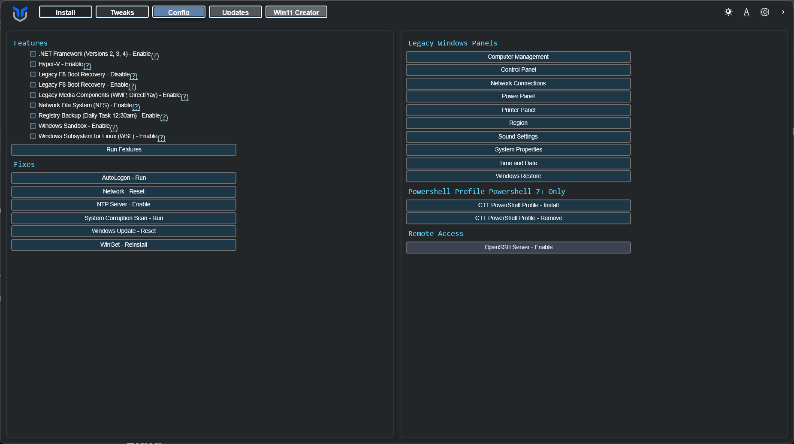

Use as seções **Recursos** e **Correções** para instalar componentes opcionais do Windows e executar tarefas comuns de reparo.

Esta página corresponde à aba **Configurações** do WinUtil. Algumas ações terminam na hora, enquanto outras podem pedir confirmação, baixar arquivos da Microsoft ou exigir uma reinicialização antes que a mudança fique totalmente disponível.

## Recursos do Windows

Instale **recursos do Windows** comuns marcando as caixas de seleção dos recursos e clicando em **Instalar recursos**.

Se um recurso depender da mídia de instalação do Windows ou de downloads opcionais, o Windows pode levar mais tempo para concluir ou pedir uma reinicialização.

* Todos os .NET Frameworks (2, 3, 4)
* Virtualização Hyper-V
* Mídia herdada (WMP, DirectPlay)
* NFS - Sistema de Arquivos de Rede
* Habilitar tarefa diária de backup do registro às 00:30
* Habilitar recuperação de inicialização herdada F8
* Desabilitar recuperação de inicialização herdada F8
* Subsistema do Windows para Linux
* Windows Sandbox

## Correções

Use estas correções em um clique para problemas comuns do sistema.

Use-as quando tiver um problema específico a corrigir, e não como uma etapa de limpeza de rotina.

* Configurar login automático
* Redefinir Windows Update
* Redefinir rede
* Verificação de corrupção do sistema
* Reinstalar o WinGet

## Painéis herdados do Windows

Abra painéis antigos do Windows diretamente pelo WinUtil. Os painéis disponíveis incluem:

* Painel de Controle
* Conexões de Rede
* Painel de Energia
* Região
* Configurações de Som
* Propriedades do Sistema
* Contas de Usuário

## Acesso remoto

Habilite um servidor OpenSSH na sua máquina Windows para acesso remoto.

Habilite isso apenas se você pretende usar acesso remoto por shell. Depois de ativá-lo, verifique suas regras de firewall e permissões de conta antes de expor a máquina a outros dispositivos.

Como o WinUtil é executado com privilégios elevados, a conta que ele configura é de administrador, e o sshd lê as chaves de administrador em `C:\ProgramData\ssh\administrators_authorized_keys`, em vez do seu perfil. O WinUtil cria esse arquivo e o restringe a Administradores e SYSTEM, que é o que o sshd exige. Adicione suas chaves públicas lá. Se uma versão anterior do WinUtil alterou o `sshd_config` para ler as chaves de administrador de `%USERPROFILE%\.ssh\authorized_keys`, isso é desfeito e as chaves existentes nele são copiadas, para que a autenticação por chave continue funcionando.

Contas que não são de administrador continuam usando `%USERPROFILE%\.ssh\authorized_keys` e não precisam de configuração extra.

Se um recurso opcional do Windows não estiver disponível ou falhar ao ser habilitado, o WinUtil registra a falha e continua com os recursos opcionais restantes. Os scripts de configuração dependentes dessa seleção são ignorados quando um recurso opcional falha. O status final da tarefa ainda relata os erros.
