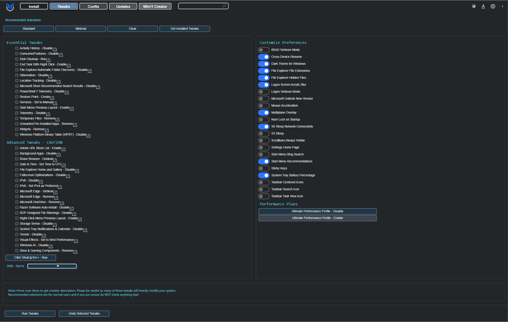

Use a aba Ajustes para aplicar mudanças recomendadas no Windows, revisar predefinições opcionais e ajustar algumas configurações complementares, como DNS e planos de energia. Comece por uma predefinição, a menos que você já saiba quais ajustes individuais quer.

### Seleções recomendadas
Use os botões de seleção rápida no topo da aba Ajustes para acelerar a configuração:

* **Padrão**: Seleciona o conjunto de ajustes de base recomendado para a maioria dos usuários.
* **Mínimo**: Seleciona um conjunto menor e de menor impacto de ajustes comuns.
* **Avançado**: Seleciona um conjunto focado de ajustes avançados mais seguros. Esta predefinição ignora de propósito a criação de ponto de restauração e as tarefas de limpeza, para evitar uma execução longa.
* **Limpar**: Limpa todos os ajustes selecionados no momento.
* **Selecionar ajustes instalados**: Detecção de melhor esforço para ajustes já aplicados ao seu sistema.

Para ajustes de caixa de seleção e entradas AppX, a busca considera as descrições das entradas e as chaves das predefinições. O próprio rótulo da dica "Chave da predefinição:" não conta como correspondência. A busca de interruptores considera o rótulo exibido e a descrição.

### Executar ajustes
* **Abra a aba Ajustes**: Navegue até a aba **Ajustes** do aplicativo.
* **Selecione os ajustes**: Escolha os ajustes que deseja aplicar. Você pode usar as predefinições disponíveis no topo, por conveniência.
* **Execute os ajustes**: Depois de selecionar os ajustes desejados, clique em **Executar ajustes** na parte inferior da tela.

:::note
Para ver o que cada predefinição inclui, consulte o [preset.json](https://github.com/RamonMods/WinUtil/blob/main/config/preset.json).
:::

Quando um serviço listado não existe, o WinUtil registra um aviso e o ignora. Os demais serviços e ajustes continuam sendo executados.

Quando o Microsoft Edge já está ausente, o ajuste de remoção do Edge o informa como não instalado e ignora o desinstalador, em vez de registrar erros.

:::caution
Alguns ajustes têm efeito imediato, enquanto outros podem exigir a reinicialização do Explorer, saída da conta ou uma reinicialização completa.
:::

O progresso de aplicar e desfazer usa o rótulo exibido de cada ajuste, como "Telemetria - Desabilitar". Os logs da sessão mantêm a chave da predefinição para fins de diagnóstico.

Enquanto aplica ou desfaz ajustes, a aba mostra um indicador de carregamento e o status ao vivo. A lista de ajustes e os botões de ação voltam quando a tarefa termina; a barra de progresso mantém o resultado final.

### Desfazer ajustes
* **Abra a aba Ajustes**: Vá para a aba **Ajustes**, ao lado de **Instalar**.
* **Selecione os ajustes a remover**: Escolha os ajustes que deseja desativar ou remover.
* **Desfaça os ajustes**: Clique em **Desfazer ajustes selecionados** na parte inferior da tela para aplicar as mudanças.

O Desfazer restaura o padrão de um serviço somente quando o tipo de inicialização atual corresponde ao tipo aplicado pelo ajuste. Outros tipos de inicialização atuais são preservados e registrados como aviso. O WinUtil não rastreia se um tipo de inicialização correspondente já existia antes do ajuste, então o desfazer também pode redefinir um serviço que já tinha aquele tipo.

Revise as ações de desfazer disponíveis no [Explorador de ajustes](/tweak-explorer/). O filtro **Tem desfazer** dele identifica ajustes com ação de desfazer, que podem redefinir padrões ou reinstalar software sem recuperar dados apagados ou suas configurações anteriores.

### Pacotes AppX

Abra **Remoção de AppX** na aba Ajustes para gerenciar os apps do Windows listados. Selecione um ou mais pacotes e escolha **Instalar selecionados** ou **Remover selecionados**.

Ao instalar um pacote selecionado, o WinUtil primeiro registra um `AppxManifest.xml` local existente. Se não restar nenhum manifesto local utilizável, o WinUtil instala o pacote da Microsoft Store pelo WinGet quando há um ID de produto da Store disponível.

Um pacote sem manifesto local utilizável nem ID de produto da Store é relatado como falha. Os demais pacotes selecionados ainda são tentados, e o resumo final lista as falhas.

Durante a instalação ou remoção de AppX, a barra de progresso da janela mostra o pacote atual, a contagem de pacotes concluídos e o progresso geral. A barra de tarefas do Windows também reflete o progresso e o estado final de sucesso ou falha.

### Ajustes essenciais
Os Ajustes essenciais são o ponto de partida mais seguro para a maioria dos sistemas. Eles focam em mudanças de menor risco que melhoram a usabilidade, reduzem ruído e evitam as mudanças mais invasivas encontradas nas opções avançadas.

**BitLocker - Desabilitar** informa quando a unidade do sistema já está totalmente descriptografada e ignora a desativação novamente. Uma unidade criptografada com proteção suspensa ainda precisa ser descriptografada.

**Telemetria - Desabilitar** desabilita o serviço de Relatório de Erros do Windows (`WerSvc`) quando o tipo de inicialização dele ainda é o padrão Manual, e o desfazer restaura Manual. Remover um valor de registro de frequência de feedback que já está ausente é tratado como concluído, e não como erro. Se o Defender relatar o erro `0x800106ba` ao alterar o envio automático de amostras, aplicar e desfazer registram um aviso e continuam com as demais mudanças de telemetria. Essa preferência do Defender é deixada inalterada; outros erros do Defender são relatados como falhas.

### Ajustes avançados (CUIDADO)

**Menu de contexto - Layout anterior - Habilitar** tenta restaurar o menu de contexto clássico do Explorador de Arquivos em builds mais recentes do Windows 11; a compatibilidade varia. O registro mais recente é deixado inalterado se já existir. O desfazer remove esse registro apenas quando o WinUtil o criou e ele não foi personalizado depois. Aplicar e desfazer reiniciam o Explorer apenas na sessão atual. O Criador do Win11 aplica o mesmo contorno mais recente durante o primeiro logon.

**Serviços - Definir como Manual** altera apenas as configurações de inicialização de serviços. Aplicar muda um serviço somente enquanto o tipo de inicialização dele corresponde ao padrão do Windows registrado no ajuste. O desfazer restaura esse padrão somente enquanto o tipo de inicialização atual corresponde ao tipo definido pelo ajuste, independentemente de quem o alterou. Por exemplo, o desfazer restaura DiagTrack, CscService e SharedAccess mesmo que você os tenha desabilitado por conta própria, porque esse ajuste também os define como Desabilitado. Tipos de inicialização que não correspondem ao valor esperado são deixados como estão e registrados como aviso. Desabilitar a divisão de hosts de serviço é um ajuste avançado separado, **Divisão do svchost.exe - Desabilitar**. Ele é recomendado para sistemas de baixo desempenho com 12 GB de RAM ou menos, para reduzir a sobrecarga de memória dos hosts de serviço. Pode interferir nos serviços do Xbox; use-o apenas quando você entender essa contrapartida. O desfazer restaura o limite padrão do cliente Windows de 0x380000, e não um limite personalizado que você tenha configurado antes. Se você aplicou o ajuste anterior de Serviços, selecione **Divisão do svchost.exe - Desabilitar** e execute **Desfazer ajustes selecionados** diretamente; não aplique o novo ajuste antes. Reinicie o Windows depois de mudar essa configuração.

**Indexação de Pesquisa do Windows - Desabilitar** interrompe o serviço de Pesquisa do Windows e o define como Desabilitado. Isso reduz a atividade de disco em segundo plano em discos mecânicos, mas as buscas de arquivos no Explorador e no menu Iniciar ficam visivelmente mais lentas, porque o Windows deixa de manter um índice de pesquisa. Aplicar muda o tipo de inicialização somente enquanto ele ainda é o padrão Automático, e o desfazer restaura Automático somente enquanto ele ainda é Desabilitado; o serviço é parado apenas enquanto está Desabilitado e iniciado apenas enquanto está Automático. Um tipo de inicialização alterado em outro lugar, como Manual, é deixado como está e registrado como aviso.

Os Ajustes avançados são para usuários que entendem os efeitos colaterais de mudanças mais profundas no Windows. Crie um ponto de restauração primeiro, revise cada item e evite tratar a lista avançada completa como uma linha de base de um clique.

**Windows AI - Desabilitar e remover** executa a mudança do recurso Recall pelo Windows PowerShell 5.1, para evitar travamentos do DISM e erros COM no PowerShell 7 da Microsoft Store. Ele suprime reinicializações automáticas e relata falhas no log do ajuste.

**Microsoft OneDrive - Remover** ignora a limpeza de pastas quando o caminho do OneDrive está vazio ou ausente, e para o FileCoAuth e o Explorer somente quando eles estão em execução. Pastas do OneDrive não vazias, incluindo pastas que contêm apenas arquivos ocultos, são mantidas.

### O&O ShutUp10++
O [O&O ShutUp10++](https://www.oo-software.com/en/shutup10) pode ser iniciado pelo WinUtil com um clique. É uma ferramenta gratuita de privacidade para Windows que ajuda os usuários a gerenciar telemetria, comportamento de atualizações e permissões de aplicativos. O botão baixa a ferramenta (cerca de 82 MB) a cada clique; passe o mouse sobre ele para ver isso antes de começar e, quando o tamanho do download estiver disponível, o rótulo de progresso o mostra junto com a porcentagem.

### DNS

Use a seção DNS para trocar os provedores de DNS IPv4 e IPv6 sem editar as configurações do adaptador manualmente. Escolha a opção que melhor corresponde à sua prioridade: velocidade, filtragem ou privacidade.

* **Padrão**: Usa as configurações de DNS padrão definidas pelo seu provedor de internet ou pela sua rede.
* **DHCP**: Obtém automaticamente as configurações de DNS do servidor DHCP.
* **Mais rápido**: Compara os tempos de conexão na porta TCP 53 com Google e Cloudflare e aplica o provedor mais rápido. Provedores de filtragem são excluídos. Se as duas sondagens falharem, as configurações de DNS existentes são preservadas. A verificação leva até cerca de três segundos; o tempo de conexão é apenas uma estimativa aproximada de latência, não um teste de consulta DNS nem de desempenho de DNS-over-HTTPS.
* [**Google**](https://developers.google.com/speed/public-dns?hl=en): Um serviço de DNS confiável e rápido fornecido pelo Google.
* [**Cloudflare**](https://developers.cloudflare.com/1.1.1.1/): Conhecido pela velocidade e privacidade, o DNS da Cloudflare é uma escolha popular para melhorar o desempenho da internet.
* [**Cloudflare_Malware**](https://developers.cloudflare.com/1.1.1.1/setup/#:~:text=Use%20the%20following%20DNS%20resolvers%20to%20block%20malicious%20content%3A): Oferece proteção adicional ao bloquear sites de malware.
* [**Cloudflare_Malware_Adult**](https://developers.cloudflare.com/1.1.1.1/setup/#:~:text=Use%20the%20following%20DNS%20resolvers%20to%20block%20malware%20and%20adult%20content%3A): Bloqueia malware e conteúdo adulto, oferecendo uma filtragem mais abrangente.
* [**Open_DNS**](https://www.opendns.com/setupguide/#familyshield): Oferece filtragem personalizável e recursos de segurança aprimorados.
* [**Quad9**](https://quad9.net/): Foca em segurança, bloqueando domínios maliciosos conhecidos.
* [**AdGuard_Ads_Trackers**](https://adguard-dns.io/en/welcome.html): O AdGuard DNS bloqueia anúncios, rastreadores e outras requisições DNS indesejadas. Visite o site e faça login para obter um painel, estatísticas e personalização adicional no lado do servidor.
* [**AdGuard_Ads_Trackers_Malware_Adult**](https://adguard-dns.io/en/welcome.html): O AdGuard DNS bloqueia anúncios, rastreadores, malware e conteúdo adulto, e habilita a Pesquisa Segura e o Modo Seguro quando possível.

### Personalizar preferências

Use Personalizar preferências para mudanças visuais e de comportamento menores que não se encaixam nas principais predefinições de ajustes.

O [Explorador de ajustes](/tweak-explorer/) mostra os valores de registro de cada estado da lista suspensa Multiplane Overlay. Selecionar um estado no WinUtil o aplica imediatamente. Escolha outro estado para revertê-lo; **Desfazer ajustes selecionados** não gerencia listas suspensas.

### Planos de desempenho

Use Planos de desempenho para habilitar ou remover o perfil de energia Alto Desempenho Máximo.

#### Adicionar e ativar o perfil Alto Desempenho Máximo:
* Habilita e ativa o perfil Alto Desempenho Máximo para melhorar o desempenho do sistema, minimizando a latência e aumentando a eficiência.
#### Remover o perfil Alto Desempenho Máximo:
* Desativa o perfil Alto Desempenho Máximo, mudando o sistema para o perfil Equilibrado.
