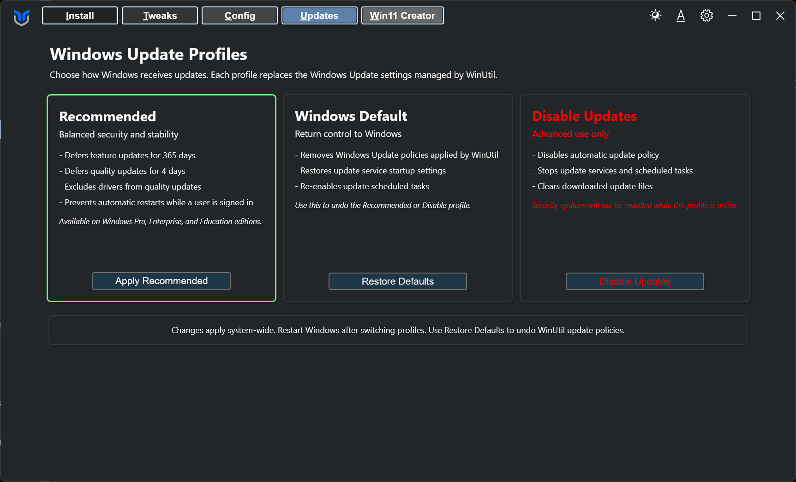

O WinUtil oferece três modos de atualização para você escolher com que intensidade o Windows Update é gerenciado no seu sistema:

Mudar de modo ajusta o comportamento do Windows Update em todo o sistema. Depois de trocar de modo, dê um tempo para o Windows aplicar a política e conte com uma reinicialização caso o novo estado não apareça de imediato.

- **Recomendado**: Prioriza a estabilidade e ainda recebe atualizações de segurança
- **Padrão do Windows**: Restaura o comportamento padrão do Windows Update
- **Desabilitar atualizações**: Bloqueia o Windows Update e deve ser usado apenas com extrema cautela

### Padrão do Windows

- **O que faz**: Remove as políticas do Windows Update gerenciadas pelo WinUtil, restaura as configurações de inicialização dos serviços de atualização e reabilita as tarefas agendadas de atualização.
- **Ideal para**: Sistemas em que você quer que o Windows gerencie as atualizações normalmente.
- **Observações**: Apenas os valores gerenciados pelo WinUtil são removidos; outras políticas do Windows Update são mantidas. O WinUtil tenta remover regras explícitas de negação para a conta SYSTEM das chaves de registro dos serviços de atualização e restaurar o `WaaSMedicSvc` para Manual. Chaves protegidas podem impedir esses reparos; as falhas são registradas como avisos. Se os erros de atualização continuarem, use a opção de redefinição na aba **Configurações** para reparar os componentes do Microsoft Update.

### Recomendado

- **O que faz**: Aplica uma estratégia de atualização mais conservadora, projetada para a maioria dos usuários.
- **Atualizações de recursos**: Adiadas em **365 dias** para reduzir a chance de transtornos com mudanças grandes no Windows.
- **Atualizações de qualidade**: Adiadas em **4 dias** para dar tempo de surgirem os primeiros problemas, mantendo o sistema protegido.
- **Drivers**: Excluídos das atualizações de qualidade do Windows.
- **Instalação**: As atualizações são baixadas automaticamente e você é avisado quando estão prontas para instalar. Essa configuração não controla as reinicializações após a instalação.
- **Disponibilidade**: As políticas de adiamento de atualizações se aplicam às edições Windows Pro, Enterprise e Education.
- **Por que usar**: Este modo oferece o melhor equilíbrio entre segurança e estabilidade, e é por isso que é a opção recomendada para a maioria dos PCs.

### Desabilitar atualizações (NÃO RECOMENDADO!)

- **O que faz**: Desabilita a política de atualização automática, para e desabilita os serviços de atualização, desabilita as tarefas agendadas de atualização e limpa os arquivos de atualização baixados.
- **Ideal para**: Sistemas altamente controlados ou de propósito específico, em que as atualizações precisam ficar desligadas temporariamente.
- **Aviso**: Isso deixa o sistema sem patches de segurança e aumenta significativamente o risco de segurança.
- **Observações**: O serviço de manutenção do Windows pode restaurar os componentes de atualização em algumas circunstâncias. Use **Restaurar padrões** quando estiver pronto para receber atualizações novamente.
- **Recomendação**: Evite este modo, a menos que você entenda completamente as contrapartidas e tenha um motivo específico para usá-lo.
