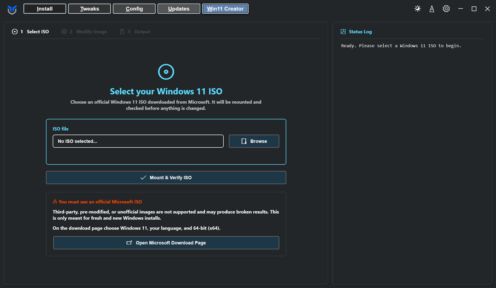

import { Tabs, TabItem } from '@astrojs/starlight/components';

## Usando o Criador do Win11 do WinUtil

O WinUtil inclui uma ferramenta **Criador do Win11** que permite pegar uma ISO oficial do Windows 11 e produzir uma versão personalizada, sem bloatware. A imagem resultante pode remover telemetria, ignorar as verificações de requisitos de hardware e habilitar a configuração com conta local de fábrica. Você pode exportar o resultado como um novo arquivo ISO ou gravá-lo diretamente em um pendrive.

:::caution
Você precisa de uma **ISO oficial do Windows 11** do [site da Microsoft](https://www.microsoft.com/en-us/software-download/windows11) antes de começar. ISOs personalizadas, modificadas ou não oficiais não são suportadas. O processo usa cerca de 10–15 GB de espaço temporário em disco, então verifique se há espaço livre.
:::

:::note
Este fluxo de trabalho é indicado para instalações novas do Windows, não para atualizações no local de uma instalação existente.
:::

---

A aba é um assistente de três etapas. A etapa em que você está aparece na linha do cabeçalho, e você pode clicar em uma etapa anterior para voltar até que a imagem tenha sido modificada. O log de status à direita fica visível o tempo todo.

### Etapa 1 — Selecione sua ISO oficial do Windows 11

1. Abra o WinUtil e vá para a aba **Criador do Win11**.
2. Clique em **Procurar** e selecione seu **arquivo ISO oficial do Windows 11** da Microsoft (deve ter 4 GB ou mais). ISOs personalizadas ou modificadas não são suportadas.
3. O caminho e o tamanho do arquivo aparecem na tela depois da seleção.
4. Clique em **Montar e verificar ISO**. O WinUtil monta a ISO, verifica se há um `install.wim` ou `install.esd` válido e lê as edições disponíveis (Home, Pro, Enterprise etc.).

:::note
A montagem e a verificação levam cerca de 10–30 segundos, dependendo da velocidade da sua unidade.
:::

---

### Etapa 2 — Modifique a imagem

Depois que a ISO é verificada, o WinUtil passa para esta etapa e mostra a unidade montada e o arquivo de imagem. Escolha sua **edição** na lista suspensa — Pro vem selecionada por padrão, se disponível — e marque **Injetar drivers do sistema atual** se quiser usá-los.

Em seguida, clique em **Executar modificação e criação da ISO do Windows** para iniciar o processo de personalização. O WinUtil vai:

**Remoção de apps e componentes:**
- **Remover 19 apps indesejados** — Clipchamp, Teams, Dev Home, novo Outlook, apps do Bing, Solitaire e outros
- **Desinstalar o OneDrive** durante o primeiro logon

**Personalização do sistema:**
- **Ignorar verificações de hardware** — remove a exigência de TPM, Secure Boot, CPU, RAM e armazenamento, para que a ISO seja instalada em hardware sem suporte
- **Habilitar configuração com conta local** — injeta um `autounattend.xml` que pula a tela de conta da Microsoft durante a OOBE
- **Desabilitar BitLocker e criptografia de dispositivo** — remove a sobrecarga na inicialização
- **Desabilitar o ícone do Chat** — remove o botão de chat da barra de tarefas
- **Fixar a edição selecionada durante a instalação** — grava metadados de instalação para que chaves de firmware OEM de outra edição não levem o instalador pelo caminho de chave de produto errado

**Ajustes de privacidade e telemetria:**
- **Desabilitar telemetria** — ID de publicidade, experiências personalizadas, personalização de entrada, privacidade online de fala
- **Desabilitar recursos de conteúdo na nuvem** — sugestões de apps, recomendações da Microsoft Store
- **Remover tarefas agendadas de telemetria** — CEIP, Appraiser, WaaSMedic e outras
- **Desabilitar backup de pastas do OneDrive** — impede backups automáticos na nuvem
- **Impedir a instalação do DevHome e do Outlook após a configuração**
- **Impedir a instalação do Teams** — bloqueia a instalação automática após a OOBE
- **Impedir a instalação do novo app Outlook Mail**
- **Desabilitar o Windows Update durante a OOBE** — reabilitado automaticamente no primeiro login
- **Desabilitar o Copilot e as sugestões da caixa de pesquisa**

**Opcional: injeção de drivers**
- Se habilitada, o WinUtil exporta os drivers do seu sistema atual, injeta os drivers de inicialização e armazenamento no `boot.wim` (Instalação do Windows, índice 2) e injeta os pacotes elegíveis na imagem `install.wim` selecionada. Pacotes duplicados obsoletos são excluídos antes da injeção. Cada pacote restante é adicionado separadamente, para que um pacote incompatível não interrompa os outros. Se um pacote falhar, o WinUtil descarta a montagem parcial e tenta os pacotes restantes na imagem original. Verifique o log ao vivo em busca de avisos: se todos os pacotes falharem, o WinUtil mantém o `install.wim` original e ainda gera a ISO.

:::note
A injeção de drivers exige `sources\install.wim`. Se a ISO usar `sources\install.esd`, deixe esta opção desligada.
:::

Um log ao vivo mostra o progresso conforme cada etapa é concluída. Sem injeção de drivers, o WinUtil grava as mudanças de instalação em poucos segundos após a cópia da ISO. Com injeção de drivers, esta fase costuma levar **10–20 minutos**, dependendo do hardware. Deixe o WinUtil aberto até o log informar a conclusão.

:::note
A ISO resultante fica próxima do tamanho da ISO de origem. O WinUtil não remove as edições não utilizadas do `install.wim`; ele seleciona sua edição por meio de `sources\ei.cfg` e `autounattend.xml`, para que a Instalação do Windows instale a correta.
:::

---

### Etapa 3 — Exporte o resultado

Depois que a modificação termina, escolha como salvar sua imagem:

<Tabs>
<TabItem label="Salvar como ISO">
1. Clique em **Salvar como arquivo ISO**.
2. Escolha um local para salvar (por padrão, a Área de Trabalho, como `Win11_Modified_yyyyMMdd.iso`).
3. O WinUtil monta uma ISO inicializável em BIOS/UEFI usando o `oscdimg.exe`.

:::note
O `oscdimg.exe` (parte do Windows ADK) é obrigatório. Se não for encontrado, o WinUtil tentará instalá-lo automaticamente pelo WinGet. Se isso falhar, instale manualmente: `winget install -e --id Microsoft.OSCDIMG`
:::
</TabItem>
<TabItem label="Gravar em pendrive">
1. Clique em **Gravar diretamente em um pendrive**.
2. Selecione seu pendrive na lista suspensa (clique em **Atualizar** se ele não aparecer).
3. Clique em **Apagar e gravar no pendrive** e confirme o aviso — **todos os dados da unidade serão apagados permanentemente**.
4. O WinUtil formata a unidade como GPT com uma única partição FAT32 (limitada a 32 GB, dividindo o `install.wim` em arquivos `.swm` se ele for maior que 3,8 GB) e copia os arquivos modificados do Windows.

:::note
O WinUtil não consegue dividir `install.esd`. Se esse arquivo tiver 4 GB ou mais, salve uma ISO em vez de gravar em um pendrive FAT32.
:::

:::danger
Confirme duas vezes se você selecionou a unidade correta antes de confirmar. Esta operação não pode ser desfeita.
:::

**Tamanho mínimo do pendrive:** 8 GB recomendado. A gravação leva de 10 a 20 minutos.
</TabItem>
</Tabs>

---

### Começar de novo (opcional)

Clique em **Começar de novo** para apagar o diretório de trabalho temporário (cerca de 10–15 GB) e devolver a ferramenta ao estado inicial, pronta para uma nova ISO. Será pedida confirmação antes de qualquer exclusão.

---

### O que a ISO modificada faz diferente

Ao instalar o Windows 11 a partir da sua ISO modificada:

- **Nenhuma conta da Microsoft necessária** — crie uma conta local diretamente durante a instalação
- **Sem verificações de hardware** — instala em máquinas sem TPM 2.0, Secure Boot ou CPUs suportadas
- **Modo escuro habilitado por padrão**
- **Barra de tarefas e Menu Iniciar vazios** — sem apps fixados, ícone do Chat removido
- **Windows Update desabilitado durante a OOBE** — reabilitado automaticamente no primeiro login para evitar interrupções na instalação
- **BitLocker desabilitado** — remove a sobrecarga na primeira inicialização

---

### Reinicialização no primeiro logon

Após a instalação, o WinUtil reinicia o Windows somente depois que os scripts de personalização do sistema e do usuário terminarem. Se a personalização do usuário não sinalizar conclusão em até cinco minutos depois do término da personalização do sistema, a reinicialização automática é ignorada. Verifique `C:\Windows\Setup\Scripts\FirstLogon.log` e `%TEMP%\UserOnce.log` antes de reiniciar manualmente.

### Solução de problemas

| Problema | Correção |
|---------|-----|
| "install.wim / install.esd was not found" | A ISO não tem imagem de instalação do Windows — baixe uma ISO oficial nova da Microsoft |
| "oscdimg.exe not found" | Execute `winget install -e --id Microsoft.OSCDIMG` e tente de novo |
| O pendrive não aparece | Conecte-o, aguarde alguns segundos e clique em **Atualizar** |
| A injeção de drivers parece travada | O serviço de WIM pode pausar em uma montagem ou gravação. Aguarde 10–20 minutos conforme o hardware e verifique o log ao vivo antes de fechar o WinUtil |
| Erro "Acesso negado" | Verifique se o WinUtil está sendo executado como Administrador |
| Aviso na injeção de drivers | Consulte o log ao vivo para o pacote indicado. Os outros pacotes compatíveis continuam; se nenhum funcionar, a ISO é criada com o `install.wim` original |
| Erro do DISM com uma explicação entre parênteses, como "exit code 112 (Disk is full)" | O WinUtil agora explica falhas comuns do DISM em linguagem simples. Libere espaço em disco para o erro "Disk is full", ou execute o WinUtil como Administrador para o erro "Access denied". Se o código não tiver explicação, busque o número na [referência de códigos de erro do DISM](https://learn.microsoft.com/en-us/windows/win32/debug/system-error-codes) da Microsoft |
| "Setup has failed to validate the product key" | Recrie a ISO com a versão mais recente do WinUtil. O criador agora remove `PID.txt` obsoletos, grava `sources\ei.cfg` e fixa a imagem selecionada em `autounattend.xml`, para que a instalação não use uma chave OEM embutida de outra edição |

---

## Recursos adicionais

- Baixe a mídia oficial do Windows 11 na [Microsoft](https://www.microsoft.com/en-us/software-download/windows11).
- Se você preferir gravar uma ISO pronta com outra ferramenta, opções comuns incluem o [Rufus](https://rufus.ie/) ou o [Ventoy](https://www.ventoy.net/).

:::note
Sempre baixe ISOs do Windows de fontes oficiais da Microsoft ou de ferramentas confiáveis como Rufus/UUP Dump, para evitar imagens adulteradas.
:::

:::note
ISOs mais recentes do Windows 11 podem não inicializar corretamente em versões antigas do Ventoy — verifique se o Ventoy está atualizado antes de usar. Se os problemas continuarem após atualizar, é uma limitação de compatibilidade do Ventoy, fora do controle do WinUtil.
:::

A seleção de edição usa o ID de edição independente de idioma dos metadados da imagem do Windows, então edições Pro localizadas são selecionadas corretamente. Se os metadados não puderem ser lidos, o Criador do Win11 usa os nomes de edição em inglês reconhecidos; uma edição desconhecida deixa a configuração de edição da instalação sem definição.
